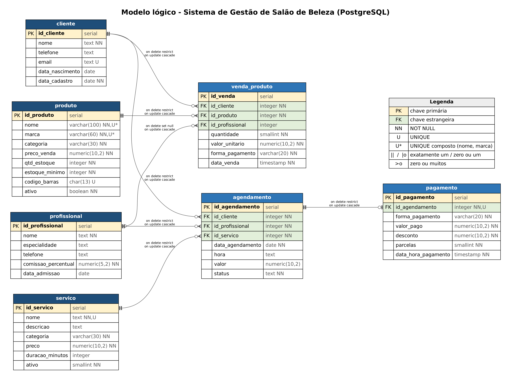

# Sistema de Gestão de Salão de Beleza

Projeto Integrador de **Banco de Dados II** (2026.2), Bacharelado em
Engenharia de Computação, IFRJ Campus Niterói.

**Equipe:** Jean de Pinho Macedo, Vinícius Pontes Braga e Pietro Gomes Borges.

Base de dados relacional (PostgreSQL, no Supabase) para um salão de beleza:
clientes, profissionais, serviços, agendamentos, pagamentos e venda de
produtos. O repositório também traz a aplicação web que usa essa base.

## Entregas do Projeto Integrador

| APD | Conteúdo | Onde está |
|---|---|---|
| APD1 | Base relacional, carga de dados, consultas e subconsultas | `database/`, `docs/`, `evidencias/apd1/` |
| APD2 | Procedures, functions e triggers | `database/` (05 a 08), `docs/`, `evidencias/apd2/` |
| APD3 | Usuários, papéis e privilégios | (em breve) |
| APD6 | Módulo NoSQL | (em breve) |
| APD7 | ETL e base analítica | (em breve) |

A documentação técnica (template do professor, atualizada a cada APD) está em
[`docs/Documentacao_Tecnica_BDII.docx`](docs/Documentacao_Tecnica_BDII.docx).

## Estrutura

```
database/
  01_criacao_tabelas.sql     criação das 7 tabelas e restrições
  02_insercao_dados.sql      carga de dados de teste (até 50 registros por tabela)
  03_consultas.sql           5 consultas simples, 5 com JOIN e 5 subconsultas
  04_testes_integridade.sql  testes das restrições (com ROLLBACK)
  05_functions.sql           3 functions
  06_procedures.sql          3 procedures
  07_triggers.sql            3 triggers (e suas funções fn_trg_)
  08_testes_apd2.sql         testes das rotinas da APD2 (com ROLLBACK)
docs/
  Documentacao_Tecnica_BDII.docx
  modelo_logico.png          modelo lógico exportado
  modelo_logico.dot          fonte editável do diagrama (Graphviz)
evidencias/apd1/             saída da execução dos scripts da APD1
evidencias/apd2/             saída da execução dos scripts da APD2 e prints
backend/                     API REST (Node.js + Express + pg)
frontend/                    aplicação React (Vite)
```

## Base de dados (APD1)

Tabelas: `cliente`, `profissional`, `servico`, `produto`, `agendamento`,
`pagamento` e `venda_produto`.



### Como recriar a base

No **SQL Editor do Supabase** (ou em qualquer PostgreSQL com `psql -f`),
execute os scripts nesta ordem:

1. `database/01_criacao_tabelas.sql` (**atenção:** apaga e recria as tabelas)
2. `database/02_insercao_dados.sql` (o SELECT final mostra a contagem por tabela)
3. `database/05_functions.sql`
4. `database/06_procedures.sql`
5. `database/07_triggers.sql`
6. `database/03_consultas.sql`
7. `database/04_testes_integridade.sql` e `database/08_testes_apd2.sql`
   (opcionais, um bloco por vez)

O 01 apaga as tabelas e, junto com elas, os triggers. Por isso, sempre que
recriar a base, execute de novo os scripts 05, 06 e 07.

Também é possível recriar a base pelo back-end, com `npm run db:init`
(executa os scripts 01, 02, 05, 06 e 07 na base configurada no `.env`).

## Tarefas e automatizações (APD2)

| Tipo | Nome | O que faz |
|---|---|---|
| Function | `fn_horario_disponivel` | Diz se o profissional está livre, considerando a duração do serviço |
| Function | `fn_comissao_profissional` | Comissão do profissional em um período |
| Function | `fn_total_gasto_cliente` | Total gasto pelo cliente em serviços e produtos |
| Procedure | `sp_concluir_atendimento` | Conclui o agendamento e registra o pagamento na mesma operação |
| Procedure | `sp_repor_estoque` | Soma a reposição ao estoque e devolve o estoque atualizado |
| Procedure | `sp_cancelar_agendamentos_expirados` | Cancela agendamentos com data passada que ficaram pendentes |
| Trigger | `trg_venda_estoque` | Baixa e estorno de estoque nas vendas, com bloqueio de estoque insuficiente |
| Trigger | `trg_pagamento_valida` | Só aceita pagamento de atendimento concluído e confere valor e desconto |
| Trigger | `trg_agendamento_regras` | Preenche o valor, bloqueia serviço inativo e conflito de horário |

Detalhes e justificativas na seção 3 da documentação técnica.

## Aplicação web

Pré-requisitos: Node.js 18 ou superior e a *connection string* do Supabase
(**Project Settings → Database → Connection pooling**), no formato
`postgresql://postgres.<ref>:<senha>@aws-<n>-<regiao>.pooler.supabase.com:5432/postgres`.

```bash
cd backend
npm install
cp .env.example .env      # edite com a sua DATABASE_URL e a porta
npm start                 # API em http://localhost:3001
npm run db:consultas      # roda as consultas de demonstração no terminal
```

```bash
cd frontend
npm install
npm run dev               # normalmente http://localhost:5173
```

Telas: **Clientes** (CRUD), **Agendamentos** (CRUD com cliente,
profissional e serviço) e **Consultas** (cliente por nome, agenda por
profissional, agenda por período e clientes que nunca agendaram).

Nunca suba o arquivo `.env` nem senhas para o GitHub. Ele já está no
`.gitignore`.
