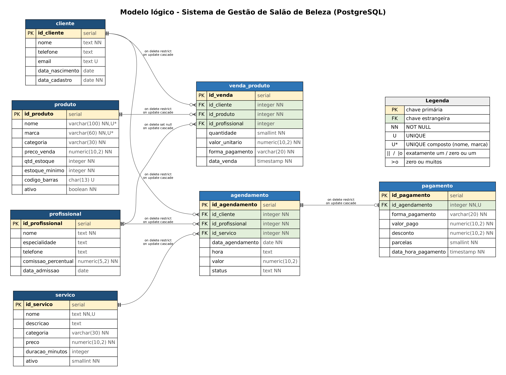

# Sistema de Gestão de Salão de Beleza

Projeto Integrador de **Banco de Dados II** (2026.2), Bacharelado em
Engenharia de Computação, IFRJ Campus Niterói.

**Equipe:** Jean de Pinho Macedo, Vinícius Pontes Braga e Pietro Gomes Borges.

Base de dados relacional (PostgreSQL, no Supabase) para um salão de beleza:
clientes, profissionais, serviços, agendamentos, pagamentos e venda de
produtos. O repositório também traz a aplicação web que usa essa base.

## Entregas do Projeto Integrador

| APD | Conteúdo | Onde está |
|---|---|---|
| APD1 | Base relacional, carga de dados, consultas e subconsultas | `database/`, `docs/`, `evidencias/apd1/` |
| APD2 | Procedures, functions e triggers | (em breve) |
| APD3 | Usuários, papéis e privilégios | (em breve) |
| APD6 | Módulo NoSQL | (em breve) |
| APD7 | ETL e base analítica | (em breve) |

A documentação técnica (template do professor, atualizada a cada APD) está em
[`docs/Documentacao_Tecnica_BDII.docx`](docs/Documentacao_Tecnica_BDII.docx).

## Estrutura

```
database/
  01_criacao_tabelas.sql     criação das 7 tabelas e restrições
  02_insercao_dados.sql      carga de dados de teste (50+ registros por tabela)
  03_consultas.sql           5 consultas simples, 5 com JOIN e 5 subconsultas
  04_testes_integridade.sql  testes das restrições (com ROLLBACK)
docs/
  Documentacao_Tecnica_BDII.docx
  modelo_logico.png          modelo lógico exportado
  modelo_logico.dot          fonte editável do diagrama (Graphviz)
evidencias/apd1/             saída da execução dos scripts
backend/                     API REST (Node.js + Express + pg)
frontend/                    aplicação React (Vite)
```

## Base de dados (APD1)

Tabelas: `cliente`, `profissional`, `servico`, `produto`, `agendamento`,
`pagamento` e `venda_produto`.



### Como recriar a base

No **SQL Editor do Supabase** (ou em qualquer PostgreSQL com `psql -f`),
execute os scripts nesta ordem:

1. `database/01_criacao_tabelas.sql` (**atenção:** apaga e recria as tabelas)
2. `database/02_insercao_dados.sql` (o SELECT final mostra a contagem por tabela)
3. `database/03_consultas.sql`
4. `database/04_testes_integridade.sql` (opcional, um bloco por vez)

Também é possível recriar a base pelo back-end, com `npm run db:init`
(executa os scripts 01 e 02 na base configurada no `.env`).

## Aplicação web

Pré-requisitos: Node.js 18 ou superior e a *connection string* do Supabase
(**Project Settings → Database → Connection pooling**), no formato
`postgresql://postgres.<ref>:<senha>@aws-<n>-<regiao>.pooler.supabase.com:5432/postgres`.

```bash
cd backend
npm install
cp .env.example .env      # edite com a sua DATABASE_URL e a porta
npm start                 # API em http://localhost:3001
npm run db:consultas      # roda as consultas de demonstração no terminal
```

```bash
cd frontend
npm install
npm run dev               # normalmente http://localhost:5173
```

Telas: **Clientes** (CRUD), **Agendamentos** (CRUD com cliente,
profissional e serviço) e **Consultas** (cliente por nome, agenda por
profissional, agenda por período e clientes que nunca agendaram).

Nunca suba o arquivo `.env` nem senhas para o GitHub. Ele já está no
`.gitignore`.
